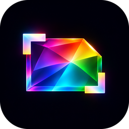
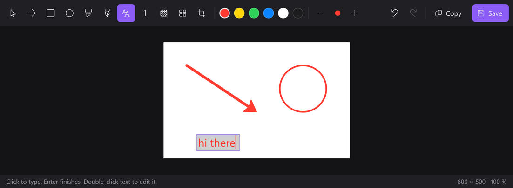
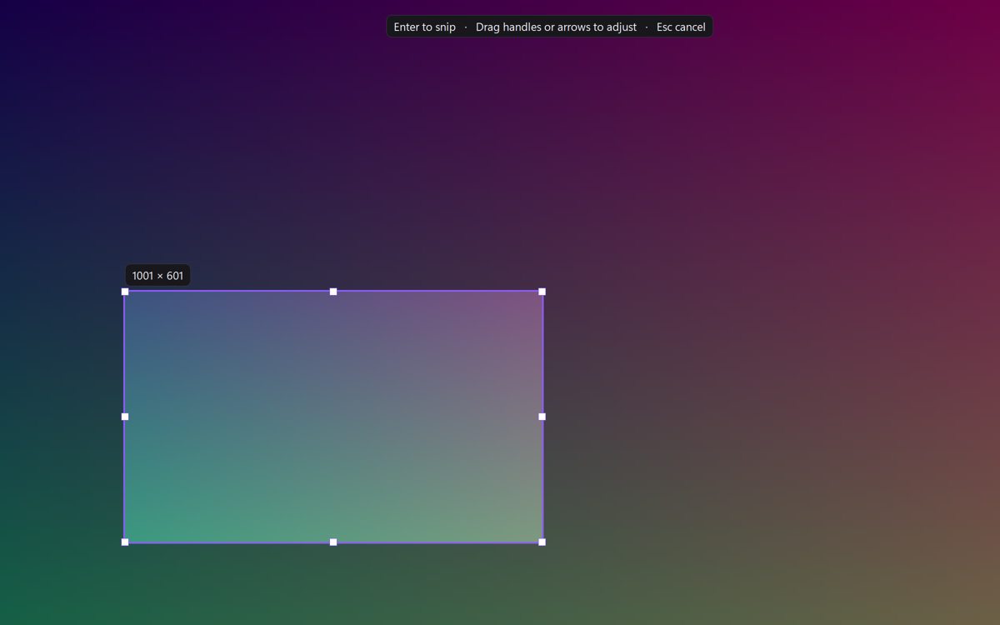

<div align="center">



# Glint

**A fast, tiny snipping tool for Windows 11. Snip, it is on your clipboard. Click the preview to draw on it.**

[](https://github.com/Maxaubert/Glint/releases/latest)
[](https://github.com/Maxaubert/Glint/actions/workflows/ci.yml)
[](#install)
[](https://www.rust-lang.org)
[](LICENSE)



</div>

## Why Glint

- **Under 2 MB of RAM while it waits** in the background, with no tray icon. The editor is a separate program that starts only
  when you open it and frees everything when you close it.
- **Instant.** The screen is frozen the moment you press the hotkey (about 60 ms on a 4K screen), so
  menus and tooltips stay in the shot.
- **Clipboard first.** Every snip is copied (PNG with transparency, plus the formats older apps need).
  Nothing is saved unless you ask.

## Features

| Snip | Preview | Editor |
|---|---|---|
| `Win+Shift+S` opens the overlay (press again to close) | Card in the bottom-right corner | Arrow (drag the middle to curve it) |
| Drag a box, then fine-tune with handles or arrow keys | **Click** to open the editor | Ellipse for circling things, rectangle |
| **Right-click**: the whole screen under the mouse | **Drag** it into Discord, Slack, Explorer | Highlighter that keeps text readable |
| **Middle-click**: the same area as last time | Save with one click | Text, numbered steps, pen |
| Works with the Wind magnifier: snip while zoomed, zoom out in the overlay | Stacks when you snip quickly | Blur (permanent) |
| Works across monitors with different scaling | Never steals focus | Crop, undo, copy, save PNG, JPEG or WebP |



## Install

Download `Glint-Setup-x64-<version>.exe` from the [latest release](https://github.com/Maxaubert/Glint/releases/latest)
and run it. It installs for your user only (no admin rights) and starts with Windows.
The installer is not signed yet, so SmartScreen may warn on first run.

## Use

| Where | Key or action | Does |
|---|---|---|
| Anywhere | `Win+Shift+S` | Open the snip overlay |
| Overlay | Drag and let go | Snip the box (with `capture_on_release = false`: adjust, then `Enter`) |
| Overlay | Right-click / middle-click | Full screen / last area |
| Overlay | Arrows, `Shift`+arrows, `Ctrl` for 10 px | Move / resize the box |
| Overlay | `F`, `Shift+F`, `Esc` | Full screen, all screens, cancel |
| Editor | `V A R O H P T N B C` | Select, arrow, rectangle, ellipse, highlight, pen, text, step, blur, crop |
| Editor | `1` to `6`, `[` and `]` | Colour, thinner and thicker |
| Editor | `Ctrl+Z`, `Ctrl+Y`, `Delete` | Undo, redo, delete the selected shape |
| Editor | `Ctrl+C`, `Ctrl+S`, `Enter` | Copy, save, copy and close |

Glint has no tray icon. Open **Glint** from the Start menu while it runs to get Settings; quit it
from Settings > About.

## Settings

Open **Settings** from the gear in the editor or from Glint in the Start menu. It follows Windows light and dark mode, and every change applies within a few seconds. The same settings live in `%APPDATA%\Glint\config.toml`:

```toml
preview_seconds = 6          # how long the preview card stays
save_dir = 'D:\Screenshots'   # default: Pictures\Glint
capture_on_release = true    # snip when you let go; false = adjust the box, then Enter
hdr_capture = false          # re-capture HDR screens with tone mapping (for HDR games and video)

[hotkeys]
region = "Win+Shift+S"   # Glint takes this from the Windows Snipping Tool
fullscreen = ""              # optional, for example "Ctrl+Alt+F"
repeat = ""                  # optional, for example "Ctrl+Alt+R"
```

## Build from source

```powershell
cargo build --release                    # target\release\glint.exe and glint-editor.exe
cargo test --workspace                   # unit tests
pwsh tools/e2e/run.ps1 -Release          # end-to-end, on a hidden desktop
makensis /DVERSION=0.1.0 installer\glint.nsi   # dist\Glint-Setup-x64-0.1.0.exe
```

| Crate | Role |
|---|---|
| `glint-core` | Geometry, images, PNG and DIB codecs, clipboard, config |
| `glint-capture` | GDI screen capture, optional DXGI HDR tone mapping, monitor layout |
| `glint` | The background daemon: hotkeys, overlay, preview card (plain Win32, no UI toolkit, no tray icon) |
| `glint-editor` | The editor (Slint UI, tiny-skia drawing) |

Design notes and the roadmap of ideas: [docs/2026-11-12-v1-spec-and-plan.md](docs/2026-11-12-v1-spec-and-plan.md).

## Credits

The capture sound is "Camera shutter" (6305) from the Freesound community on
[Pixabay](https://pixabay.com/sound-effects/), used under the Pixabay Content License, pitched up one semitone.

## License

[MIT](LICENSE)
